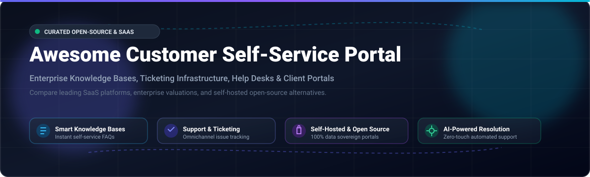

# Awesome Customer Self-Service Portal 🚀

  

  
  
  
  
  
  
  

---

## 🌟 Top Customer Self-Service Portal Ecosystem

> **A Curated List of SaaS Platforms & Self-Hosted Open-Source GitHub Projects**  
> *Focused on Self-Service Knowledge Bases, Automated Ticket Resolution, Help Desks & Customer Account Portals*  
> **Last updated: March 2026** 📅

This repository tracks notable **SaaS platforms** and **open-source projects** for **Customer Self-Service Portals**. These tools empower organizations to deliver branded, authenticated self-service environments where customers can search knowledge bases, submit and track support tickets, and manage account details independently — driving down support ticket volume, slashing operational costs, and boosting customer satisfaction (CSAT).

**Keywords & SEO Highlights:** Customer Self-Service Portal, Help Desk Software, Open Source Ticketing System, Self-Hosted Knowledge Base, Customer Support Portal, Omnichannel Support, SaaS Helpdesk Pricing, IT Service Management (ITSM), Community Forum, Client Account Portal.

---

## 📑 Table of Contents

- [📊 Sector Overview & Market Dynamics](#-sector-overview--market-dynamics)
- [☁️ SaaS/Hosted Platforms](#️-saashosted-platforms)
- [💻 Open-Source GitHub Projects](#-open-source-github-projects)
- [🤝 How to Contribute](#-how-to-contribute)
- [💖 Support](#-support)
- [📈 Star History](#-star-history)
- [📜 Disclaimer](#-disclaimer)

---

## 📊 Sector Overview & Market Dynamics

The global **Customer Self-Service (CSS) software market** is estimated at **$18B – $26B in 2025–2026** (scaling to over **$55B – $65B by 2030** at an estimated CAGR of ~15–21%), accelerated by generative AI agents, conversational search, and automated ticket deflections.

**Market Concentration & Structure:**
The sector exhibits a **barbell structure with moderate concentration at the top and high fragmentation in specialized verticals**:
- **Concentrated Enterprise Tier:** An oligopolistic core of CRM and CX enterprise giants (Salesforce, Zendesk, ServiceNow, HubSpot, Freshworks) commands the lion's share of enterprise budgets, leveraging proprietary ecosystems and AI co-pilots.
- **Fragmented Innovation Tier:** The market remains highly fragmented among mid-market contenders, niche vertical solutions (e.g., B2B-specific platforms like TeamSupport), and privacy-first **self-hosted open-source alternatives** (such as Chatwoot, FreeScout, and Zammad) catering to teams prioritizing data sovereignty, on-premise compliance, and zero vendor lock-in.

---

## ☁️ SaaS/Hosted Platforms

| Platform | Company Size / Valuation (Desc) | Pricing (Starting Tier) | Free Tier / Free Trial Limits | Description |
| :--- | :--- | :--- | :--- | :--- |
| **[Salesforce Self-Service Portal](https://www.salesforce.com/)** | ~$280B+ Market Cap (~$38B Annual Revenue) | $25 / user / month (Starter Suite, billed annually) | 30-day free trial; full access to Starter Suite features with sample data; no credit card required | Experience Cloud-powered customer portal with knowledge base, case submission, and account management. Features Lightning Community Builder for drag-and-drop customization, role-based access control, and Einstein AI for personalized content recommendations. |
| **[HubSpot Service Hub](https://www.hubspot.com/)** | ~$30B+ Market Cap (~$2.6B Annual Revenue) | $15 / seat / month (Starter plan, billed annually) | Free-for-ever plan limited to up to 5 users, basic ticketing, 1 shared inbox, and standard closed ticket reporting (Customer Portal feature requires Service Hub Pro/Enterprise or trial; 14-day free trial for Pro) | Customer portal with support form, ticket tracking, and knowledge base. Features organization-level ticket visibility and granular display controls within HubSpot CRM. |
| **[Zendesk Guide](https://www.zendesk.com/)** | ~$10.2B Valuation (Acquired by Hellman & Friedman, ~$1.7B Revenue) | $19 / agent / month (Support Team, billed annually) | 14-day free trial; full access to Zendesk Suite features across all channels; no credit card required | Customer-facing self-service portal with knowledge base, community forum, and ticket tracking. Includes authoring environment for collaborative content management and multi-brand support. |
| **[Zoho Desk Portal](https://www.zoho.com/desk/)** | ~$1.4B Annual Revenue (Privately held, ~$10B+ Valuation) | $14 / user / month (Standard plan, billed annually) | Free-for-ever plan limited to 3 free agents, email ticketing, private knowledge base, and standard macros; 15-day free trial for paid tiers with no credit card required | Self-service help center with knowledge base, guided conversations, and AI-powered Zia assistance. Supports 50+ languages and embeddable widgets. |
| **[Freshdesk Customer Portal](https://freshdesk.com/)** | ~$6B+ Market Cap (~$700M+ Annual Revenue) | $15 / agent / month (Growth plan, billed annually) | Free-for-ever plan limited to up to 10 agents, integrated email/social ticketing, ticket dispatch, and basic knowledge base; 14-day free trial for paid tiers | Branded self-service portal with knowledge base, forums, and ticket tracking. Features WCAG 2.0 AA compliant themes, multi-product support, and CAPTCHA/social login options. |
| **[Help Scout](https://www.helpscout.com/)** | ~$35M+ ARR (Privately held, backed by Riverside) | $22 / user / month (Standard plan, billed annually) | 15-day free trial; full feature access including up to 2 mailboxes, 1 Docs site, and live chat beacon; no credit card required | Customer Portal providing secure, authenticated web experience for customers to view and manage support history. Features one-time code login (no passwords) and organization-level visibility. |
| **[TeamSupport](https://www.teamsupport.com/)** | ~$15M – $25M ARR (Level Equity backed) | $29 / agent / month (Essential Messaging & Support, billed annually) | 14-day free trial; access to core ticketing and support collaboration tools; no credit card required | B2B customer support platform with customer portal, knowledge base, and ticket tracking. Features customer-specific views and SLA management. |
| **[HappyFox](https://www.happyfox.com/)** | ~$18M – $20M ARR (Privately held, Bootstrapped) | $24 / agent / month (Basic plan, billed annually) | 14-day free trial; full functionality across ticketing and support center; no credit card required | Support Center with widget-based page builder, SEO optimization, multi-lingual support (39+ languages), GDPR compliance, and extensive customization via JavaScript/CSS. |
| **[Deskpro](https://www.deskpro.com/)** | ~$25M Series A (~$8M – $12M ARR) | $39 / agent / month (Team plan, min 3–5 agents, billed annually) | 14-day free trial; full feature access to Deskpro Cloud; no credit card required | Customer service solution with self-service portal, known issue management, multi-brand/multi-language support, and on-premise or cloud deployment options. |
| **[SupportPal](https://www.supportPal.com/)** | Privately held / Bootstrapped (<$5M ARR) | $29.95 / month (per brand, unlimited operators, self-hosted) | 30-day free trial; evaluation license for 1 organization on self-hosted deployment; no credit card required | Self-hosted help desk with customer portal, knowledge base, and multi-brand support. Features internal self-service types, social login (Facebook, Google, Twitter, Steam), 2FA for users, article feedback, and dark theme options. |

---

## 💻 Open-Source GitHub Projects

Sorted descending by GitHub_Stars (with social Stars_Badges linking directly to each repository's stargazers page):

1. **[Chatwoot](https://github.com/chatwoot/chatwoot)**   
   Open-source customer engagement platform and omnichannel helpdesk (MIT). Features live chat, unified multi-channel inbox (email, WhatsApp, Twitter), team collaboration, customizable self-service help center/knowledge base, and rich client portals.

2. **[Wiki.js](https://github.com/requarks/wiki)**   
   Modern, extensible open-source wiki and documentation platform (AGPL-3.0) built on Node.js and PostgreSQL. Widely used for branded public and authenticated customer self-service knowledge portals, full-text search, and multi-lingual documentation.

3. **[UVdesk Community Skeleton](https://github.com/uvdesk/community-skeleton)**   
   Full-featured open-source helpdesk system (MIT) built with Symfony and PHP. Features custom branding, self-service knowledge base, multi-mailbox support, ticket dispatch automations, agent roles, and an extensible workflow engine.

4. **[BookStack](https://github.com/BookStackApp/BookStack)**   
   Opinionated, simple and open-source documentation and knowledge base platform (MIT) built on PHP/Laravel. Ideal for organizing customer-facing help guides, manuals, and searchable support documentation with granular user permission roles.

5. **[Answer](https://github.com/answerdev/answer)**   
   Open-source Q&A community platform (Apache-2.0) built with Go and React. Enables organizations to build interactive customer self-service community forums, technical support Q&A hubs, and peer-to-peer customer assistance ecosystems.

6. **[Zammad](https://github.com/zammad/zammad)**   
   Enterprise-grade web-based customer support and ticketing system (AGPL-3.0) built with Ruby on Rails. Includes full customer self-service web portal, comprehensive knowledge base, omnichannel ticket routing, SLA management, and audit logging.

7. **[FreeScout](https://github.com/freescout-helpdesk/freescout)**   
   Lightweight, privacy-focused open-source helpdesk and shared inbox (AGPL-3.0) written in PHP/Laravel (Zendesk / Help Scout alternative). Provides customer self-service portal modules, public/internal knowledge base modules, and live chat widgets.

8. **[osTicket](https://github.com/osTicket/osTicket)**   
   Battle-tested open-source support ticket system (GPL-2.0). Features customer web portal with ticket status tracking (with or without mandatory account registration), FAQ/knowledge base, auto-responders, and configurable ticket forms.

9. **[Frappe Helpdesk](https://github.com/frappe/helpdesk)**   
   Modern, streamlined open-source ticket management platform (GPL-3.0) built on Frappe and Vue 3. Features clean dual portals for agents and end customers, advanced knowledge base, customizable SLAs, canned replies, and turnkey Docker support.

10. **[Helpy](https://github.com/helpyio/helpy)**   
    Mobile-friendly, modern open-source customer support application (MIT) built on Ruby on Rails. Features seamless customer self-service portal, multi-lingual knowledge base, customer community discussion forums, and multi-channel ticket management.

11. **[Documize Community](https://github.com/documize/community)**   
    Open-source enterprise knowledge management software (GPL-3.0) written in Go. Organizes internal and customer-facing support manuals, documentation snippets, and knowledge wikis with rich Markdown/rich-text authoring.

12. **[Live Helper Chat](https://github.com/livehelperchat/livehelperchat)**   
    Open-source live support and conversational ticketing system (Apache-2.0). Features embeddable customer self-service chat widgets, FAQ bots, proactive greetings, and customer account dashboard capabilities.

13. **[Trudesk](https://github.com/polonel/trudesk)**   
    Open-source helpdesk ticketing system (MIT) built with Node.js and MongoDB. Provides a customer-facing support portal, ticket tracking, integrated knowledge base management, and real-time push notifications.

14. **[Faveo Helpdesk](https://github.com/ladybirdweb/faveo-helpdesk)**   
    Customizable helpdesk solution (OSL-3.0) built on Laravel. Includes a responsive client self-service portal, knowledge base management, automated ticketing, and multi-language support.

15. **[Request Tracker (RT)](https://github.com/bestpractical/rt)**   
    Enterprise-grade open-source issue tracking and ticketing system (GPL-2.0) by Best Practical. Offers self-service web interface for ticket creation/review, robust workflows, custom lifecycles, and fine-grained ACLs.

16. **[OpenSupports](https://github.com/opensupports/opensupports)**   
    Clean, responsive open-source support ticket platform (GPL-3.0) built with PHP and React. Features an intuitive self-service portal for ticket submission and tracking, knowledge base articles, and multi-language localization.

17. **[Znuny](https://github.com/znuny/znuny)**   
    Enterprise open-source service management system (GPL-3.0, fork of OTRS). Provides a customer self-service interface, knowledge management / FAQ modules, SLA timers, and deep ITIL service desk integration.

18. **[Open Self Service (O2S)](https://github.com/o2sdev/openselfservice)**   
    Open-source composable framework for engineering custom customer self-service portals. Features Next.js frontend starter kit, API Harmonization Server (integrates Zendesk, Medusa, Strapi, Contentful), and 25+ pre-built React/TypeScript UI components.

19. **[Umbraco Commerce Portal](https://github.com/umbraco/Umbraco.Commerce.Portal)**   
    Open-source customer portal package for Umbraco (MIT). Enables .NET developers to deploy a self-service customer portal where shoppers can authenticate, view order statuses, and manage accounts.

---

### 🧩 Architectural Framework for Custom Portals

For engineering teams constructing proprietary, sovereign customer portals:
- **Frontend / Portal UI:** Deploy **[Open Self Service (O2S)](https://github.com/o2sdev/openselfservice)** (Next.js / React) or customized Vue frontends.
- **Ticketing & Case Engine:** Integrate **[Chatwoot](https://github.com/chatwoot/chatwoot)** or **[Zammad](https://github.com/zammad/zammad)** via REST/GraphQL APIs.
- **Knowledge Base & Documentation:** Connect **[BookStack](https://github.com/BookStackApp/BookStack)** or **[Wiki.js](https://github.com/requarks/wiki)**.
- **Community Support Hub:** Embed **[Answer](https://github.com/answerdev/answer)** for customer peer discussions.

---

## 🤝 How to Contribute

Contributions are welcome and encouraged! To submit a new tool or suggest improvements:

1. 🍴 **Fork** this repository.
2. 🌿 Create a descriptive feature branch (`git checkout -b add-new-portal`).
3. ✍️ Add or update entries in `README.md` following the established tabular or list format.
4. 🔍 Ensure descriptions are objective and include official URLs and license/pricing specifications.
5. 🚀 Commit your changes and open a **Pull Request** with a brief summary of what was added.

---

## 💖 Support

If you find this curated ecosystem list helpful, please consider supporting the project:

- ⭐ **Star this repository** to show your appreciation and help others discover it!
- 🍴 **Fork and share** it with your fellow developers, DevOps engineers, and support teams.
- ☕ **Buy me a coffee / Sponsor:** Support ongoing maintenance and research on the [GitHub Sponsor Dashboard](https://github.com/sponsors/ishandutta2007).

---

## 📈 Star History

---

## 📜 Disclaimer

- This is a community-curated directory intended for research, architectural planning, and software evaluation.
- Customer self-service portals handling customer PII must comply with regional data protection standards (GDPR, CCPA, HIPAA, etc.).
- Self-hosted open-source software requires routine security audits, backup strategies, and infrastructure hardening prior to production deployment.

---

  <b>Built for Support Engineers, CX Directors, Solutions Architects, and Open-Source Advocates.</b> 
  <i>Empowering organizations to build transparent, cost-efficient, and data-sovereign customer self-service portals.</i>

